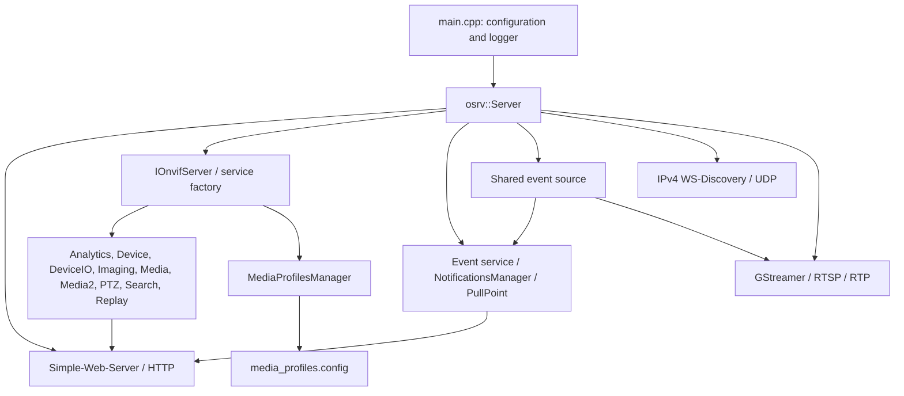

# ONVIF Server Emulator Architecture

## Purpose and Scope

The project emulates an IP camera or NVR for testing ONVIF clients. It is a C++20
application for Linux: SOAP over HTTP describes and controls the device,
GStreamer delivers media over RTSP/RTP, and WS-Discovery enables device discovery.
Some responses and capabilities are configured in files or hardcoded. The presence
of a service or capability field does not imply full implementation of the standard.

Build instructions are in [BUILD.md](../BUILD.md), configuration is described in
[README.md](../README.md), and the Windows/WSL2 deployment is covered in
[WSL2.md](WSL2.md).

## Public API Contract

The public server API, accepted requests, and emitted responses are required to
follow the applicable [ONVIF specifications](https://www.onvif.org/profiles/specifications/),
service WSDL files, and XSD schemas, including imported definitions. WSDL and XSD
define the message structure and types; the specification also defines the
meaning of parameters, operation behavior, and protocol requirements.

Changes must preserve both syntactic validity (namespaces, actions, element order,
cardinality, types, and allowed values) and semantic correctness (token references,
state transitions, time ranges, units, capabilities, access rules, and faults).
The contract covers SOAP services, discovery, events, media, and replay as
applicable. Advertised capabilities must reflect actual supported behavior.

For each protocol change, identify the specification version, WSDL, and schemas
used, and verify representative requests, responses, and faults. XML schema
validation and semantic behavior tests serve complementary purposes. Existing
fixtures do not override the normative definitions. Intentional simulation
deviations must be documented with their scope and reason.

This is an implementation requirement, not a claim that the current emulator
fully conforms to ONVIF; the limitations described below still apply.

Implementation requirements and intellectual property permissions must both be
respected. Consult the licensing rules in [AGENTS.md](../AGENTS.md#intellectual-property-and-licensing)
before copying specifications, WSDL/XSD files, examples, or generated artifacts,
or changing distributed dependencies. Preserve required notices and provenance.
Technical compatibility does not establish rights to use ONVIF branding or make
an official conformance claim; see the
[ONVIF conformance policy](https://www.onvif.org/conformant-products/).

## Source Map

| Path | Responsibility |
| --- | --- |
| `main.cpp` | Configuration directory selection, logger creation, application startup |
| `Server.h`, `Server.cpp` | Shared settings, HTTP server, subsystem initialization, base URLs |
| `include/IOnvifServer.h`, `src/IOnvifServer.cpp` | Shared context, factory and lazy SOAP service creation, media profile manager |
| `onvif_services/` | SOAP services, operation handlers, discovery, and events |
| `onvif/` | Base ONVIF request handler, recording/search models, notification serialization and scene snapshots |
| `RtspServer.h`, `RtspServer.cpp` | GStreamer RTSP server, live streams, synthetic replay |
| `rtsp/` | Metadata appsrc bridge, subscriptions, scene readers and media lifecycle |
| `utility/` | XML/SOAP/HTTP, authorization, media profiles, audio/video/PTZ configuration readers, date and time |
| `include/`, `src/onvif_services/` | Logging interfaces and service configuration loader |
| `server_configs/` | JSON `.config` files, XML response templates, snapshot JPEG |
| `unit_tests/` | Boost.Test suites, fixtures, separate Python network smoke test |
| `Simple-Web-Server/` | Git submodule providing an HTTP server based on Boost.Asio |
| `docker/`, `scripts/windows/` | Container builds, mirrored WSL2 deployment, Windows firewall configuration |

## Startup and Component Relationships

1. `main.cpp` accepts an optional first argument specifying the configuration
   directory. The default is `./server_configs`, relative to the current working
   directory. `common.config` selects the logging level and output (`console` or
   `file`, with file output written to `OnvifServer.log`).
2. `Server` is created through a `shared_ptr`. Its `IOnvifServer` base creates the
   shared HTTP server and `MediaProfilesManager`, which reads `media_profiles.config`.
   The service factory uses `shared_from_this()`.
3. `Server::init()` loads shared settings, sets the HTTP bind address and port,
   creates a digest session, and shares the manager's authoritative profile tree.
4. Discovery is initialized and started before event generators: a bind or
   multicast interface join failure must abort startup at this stage.
5. `Run()` is called on nine SOAP services. The Event service is then initialized
   separately, the RTSP server is created, and the Asio context for response delays
   is started.
6. `Server::run()` starts HTTP in a separate thread, starts RTSP, and waits for
   the HTTP thread to finish.

HTTP, discovery, events, and RTSP use separate event loops. Discovery has its own
Asio context and worker thread; `EventSource` owns the event context and worker,
with PullPoint timers on that context. RTSP runs a GLib main loop in a separate
thread. An additional Asio
context in `Server` handles simulated network delays in the Event service.

## SOAP Request Handling

Most services inherit from `IOnvifService`. `OnvifServiceFactory` maps a service URI
to a class and configuration file name. `IOnvifService::Run()` reads XML namespaces
from the service settings, obtains the XAddr path from `device.config` /
`GetServices`, and registers a POST route on the shared HTTP server.

A typical request follows this path:

1. The HTTP route passes the body to `exns::Parser` from `utility/XmlParser.*`.
2. The shared `RequestHandler` in `IOnvifService.cpp` extracts the operation name
   from the SOAP body and finds a handler in the service's `Handlers()` list.
3. In `DIGEST` mode, credentials and the handler's access level are checked.
4. A handler derived from `OnvifRequestBase` builds the response using
   Boost.PropertyTree and the `SoapHelper` / `HttpHelper` functions.
5. Known media profile errors become SOAP faults. An unknown operation returns
   HTTP 400; an unhandled exception returns HTTP 500.

The Event service is implemented separately through `event::init_service()` and
`utility::http::RequestHandlerBase` handlers; it does not use `IOnvifService`.
Its dispatch, authentication, and error handling need separate review when changing
shared SOAP service behavior.

`AUTH_SCHEME` and configuration list `none`, `ws-security`, `digest`, and
`digest/ws-security`, but the shared dispatchers for ordinary services and the
Event service check credentials only for `AUTH_SCHEME::DIGEST`. The mode list does
not establish that WS-Security or the combined mode is implemented.

## Configuration and State

`ServiceConfigs` reads JSON through Boost.PropertyTree from `<service name>.config`.
Names are case-sensitive and use lowercase snake_case without spaces, such as
`device.config`, `device_io.config`, `media2.config`, `recording_search.config`,
and `replay_control.config`.
Settings are read during component construction or initialization; there is no
shared hot-reload mechanism.

- `common.config`: bind/advertised endpoints, RTP range, users, authentication,
  logging, delay and channel simulation, and the RTSP input file.
- `device.config`: device description, service list and XAddrs, and emulated digital
  inputs. `Enabled` in `GetServices` controls service advertisement;
  `Server::init()` still calls `Run()` on all nine services.
- `media_profiles.config`: profiles and associated source/encoder configurations.
  `ProfilesConfig()` shares the manager's authoritative tree; metadata factories
  receive immutable copies of settings and compiled filters.
- `event.config`: namespaces, event properties, generators, and PullPoint settings.
- `discovery.config`: discovery enablement and local multicast interface selection.
- Other service `.config` files: data for the corresponding SOAP operations.

`MediaProfilesManager` uses `ConfigsReaderWriter` and persists profile changes to
the JSON file. Profile mutation requires write access to the configuration
location; a read-only mount is suitable for scenarios without those operations.
Snapshots are served from `rs/snapshot.jpeg`, rather than extracted from the
current RTSP stream.

## Network Addresses

`ServerConfigs` separates socket binding from addresses returned to clients:

| Setting | Meaning |
| --- | --- |
| `addresses.ipv4`, `http_port`, `rtsp_port` | Listening address and ports; defaults: `0.0.0.0`, `8080`, `8554` |
| `advertised.ipv4` | Concrete IPv4 used in client URLs; default: `127.0.0.1` |
| `ONVIF_ADVERTISED_IPV4` | Environment override for `advertised.ipv4` |
| `advertised.http_port`, `rtsp_port`, `pullpoint_port` | Client ports; `0` selects the listening port subject to the rules below |
| `portForwardingSimulation` | Legacy HTTP/RTSP client port overrides; explicit advertised ports take precedence |
| `rtp.port_min`, `port_max` | UDP RTP/RTCP pool; default: `50000–50199`, with an even first port and odd last port |

URLs are built through `HttpAddress()`, `RtspAddress()`, and `PullPointAddress()`.
PullPoint on the shared HTTP listener uses the advertised HTTP endpoint; a separate
listener uses its advertised port or `PullPoint.Port`. Advertised settings and
forwarding simulation do not create NAT or firewall rules.

WS-Discovery accepts IPv4 Probes on UDP `3702`, joins multicast group
`239.255.255.250`, and sends unicast ProbeMatch replies. `interface_ipv4` selects
a local interface; `ONVIF_DISCOVERY_INTERFACE_IPV4` overrides it. XAddrs in
`responses/ProbeMatch.response` is replaced with the HTTP endpoint during
initialization. Hello/Bye/Resolve and IPv6 discovery are not implemented.

## Media Streams and Recordings

`RtspServer.cpp` registers three fixed RTSP mount points:

| Path | Source |
| --- | --- |
| `/Live&HighStream` | Test video and audio; decodes the configured file when `fileStreaming.enabled` is set |
| `/Live&LowStream` | Separate test video stream without audio |
| `/Recording0` | Synthetic ONVIF replay using custom `ReplayBin` and `OnvifFactory` types |

Live video is encoded as H.264. `AudioSetupFactory` selects the audio setup from
the first AudioEncoder configuration. Factories share a bounded UDP port pool;
clients can use RTP/RTCP over UDP or interleaved RTSP/TCP. Many pipeline parameters
are hardcoded, so changing codec or resolution settings through SOAP does not
guarantee a change to the actual stream.

Metadata configuration/streaming is enabled by default through
`common.config` (`rtsp_metadata.enabled=true`); an explicit false disables it. Media/Media2 expose event metadata configurations
and profile associations. Profile-specific stable RTSP URIs have an application
track only when metadata is attached; per-profile factories retain immutable
settings. Persisted changes replace factories for new connections while active
sessions retain their snapshots. Startup installs profile URIs, and deletion
removes obsolete mounts. The bridge polls independent bounded source queues on
the RTSP GLib context and requests fresh filtered property state for metadata
PLAY and media synchronization points. See [RTSP Metadata](RTSP_METADATA.md).

`onvif/Recording.*` models recording descriptions, time ranges, and search sessions
for Recording Search. Replay Control returns an RTSP URI. This emulates an archive;
it does not record live video to disk.

## Analytics Rules

The Analytics service implements the Rules interface for
`tt:MotionRegionDetector`, `tt:LineDetector`, `tt:LineCounting`, `tt:FieldDetector`, `tt:LicensePlateRecognition` and `tt:FaceRecognition`. A shared `utility::AnalyticsRules`
validates and stores rule snapshots, alarm state and object history under a mutex.
`utility::line` handles Line Detector parameters and geometry. SOAP mutations persist rules
through the media manager; synthetic event generators read the shared snapshot
without accessing the manager from the event thread. Media and Media2 serialize
rules from the manager's current tree. A fixed `SyntheticObjectTracker` module
publishes immutable scene snapshots from the same samples used by Line Detector,
Line Counting and Field Detector. `onvif/SceneDescription` bounds retained frames
and objects; each RTSP bridge reads independently by video source and analytics
configuration, without accessing the media manager. Metadata settings separately
select events and analytics. Line crossing notifications are non-property events and have no
synchronization state. `utility::counting::State` tracks counts, per-object passages,
report deadlines and daily resets; only its rule configuration is persisted.
Counting reuses the Line Detector synthetic object samples. A separate one-second
event timer flushes aggregated counts and evaluates reset schedules even without
object motion. Counting is a property and participates in synchronization through
its own generator. The injected clock in `AnalyticsRules` makes deadlines testable
without sleeping. Field Detector uses the same object samples and tracks zone occupancy
across objects, with its own synchronization and lifecycle event generator.
`utility::field` validates normalized polygons and evaluates point membership.
`utility::lpr` validates License Plate Recognition parameters; a dedicated synthetic
sampler emits non-property recognition events with a structured LicensePlateInfo
ElementItem, vehicle information, speed/direction, a bounding box and optional
base64 images and image URLs. The sampler cycles five vehicle datasets with independent per-plate trajectories.
The shared context loads their ten plate-only and vehicle test PNGs once
and registers separate static image GET routes using their corresponding bytes. Rule-local plate
history enforces the repeat interval and snap line. A separate Face Recognition
sampler cycles three synthetic identities and test portraits, sharing rule persistence
and emitting non-property recognition notifications with reference/image URLs,
base64 images, normalized rectangles and face/person IDs.
See [Analytics Rules](ANALYTICS.md) for the normative
references, configuration, simulation deviations, and validation commands.

## Events and Lifecycle

`Server` owns a shared `EventSource` and injects it into the Event service and
RTSP server. `NotificationsManager` adapts that source to HTTP PullPoint;
the opt-in RTSP bridge delivers the same events as metadata. `Server::init()` supplies
registrations for additional `IEventGenerator` implementations, pairing a factory
with its topic and Source/Data field descriptions for `GetEventProperties`.
Event service invokes these factories with its
configuration, the source's Asio context and logger before starting generator
timers, and the source owns the resulting generators. Its worker serializes
generator and PullPoint operations. Factories capture shared
dependencies by value; each generator retains the dependencies needed by its
callbacks. Concrete analytics detectors are assembled in `Server`, so another
rule event generator can be registered without changing the Event service API.

Each consumer owns a bounded queue of immutable notifications. `PullPoint` adds
wait and expiration timers. Digital input, motion, cell motion, and
audio generators publish through Boost.Signals2 into the shared source. Subscription paths
have the form `/onvif/event_service/sN`; supported operations include PullMessages,
Renew, SetSynchronizationPoint, and Unsubscribe.

Subscriptions receive distinct paths and initial property states. Connecting a
subscriber does not reset generator timers. MessageLimit preserves the unsent
remainder; synchronization appends property states without clearing pending
transient events. Queue overflow records loss and permits property resynchronization.
See [Shared Event Delivery](EVENT_DELIVERY.md) for ownership, queue limits,
contract references, validation and the fixed subscription-lease simulation.

PullMessages responds when an event is available or the timer expires. It uses
`PullPoint.Timeout` from configuration and ignores the client's Timeout value.
`PullPoint.UseHttpServerPort=true` uses the main HTTP server; `false` creates a
separate listener on `PullPoint.Port` (default: `5550`).

Shutdown is partially implemented: `Server` stops discovery, releases the work
guard of its own Asio context, and joins that context's thread. RTSP destruction
closes clients/sessions, stops metadata subscriptions, quits its private GLib loop
and joins its worker. A complete application signal shutdown remains unfinished,
and the separate PullPoint HTTP listener runs in a detached thread. The Event service keeps file-level state and rejects
reinitialization. Correct restart of all subsystems and independence of multiple
servers in a single process cannot currently be assumed.

## Build and Validation

The root CMake project creates the `onvif_server` static library and the `main`
application. Dependencies include CMake 3.16+, C++20 with support for the
`std::format` calls used in the sources, Boost, pkg-config, and GStreamer RTSP
Server. `Simple-Web-Server` is a submodule. If its files are missing, CMake attempts
to initialize it through Git.

`ENABLE_UNIT_TESTS` defaults to off. Enabling it builds the Boost.Test-based
`test_executable` and registers one CTest test, `test1`, containing suites for XML,
configuration, authorization, services, profiles, recordings, and events.
For a build in `build/`, CTest runs it from
`build/unit_tests/fixtures/build/unit_tests`. CMake copies the required configuration
and test data layout into the build tree so tests that modify files do not alter
the source checkout.

`unit_tests/network_smoke.py` runs separately against a running emulator with
default service settings and authentication disabled. It checks SOAP, advertised
URLs, snapshots, unicast/multicast discovery, and video/audio RTP over TCP/UDP.
It does not start the server or configure the network. Windows/VMS acceptance
checks on the actual environment are described in [WSL2.md](WSL2.md).

The Dockerfile provides a `dev` development target and a final `runtime` image.
Both include the same pinned GStreamer metadata payloader, so the development
image supports the application's default metadata setting. The development image
also includes the compiler, build tools and Python metadata validation tools;
the runtime contains the application, configuration and runtime dependencies.
Plugin packaging and isolated transport checks are documented in the
[metadata development guide](../experiments/rtsp_metadata/README.md).
The mirrored WSL2 development Compose configuration uses host networking and
requires Docker Engine inside WSL; the root Compose file runs the published image.
See [BUILD.md](../BUILD.md) and the networking guide for these workflows.
